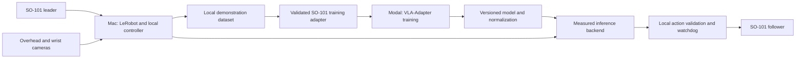

# Implementation and test plan

Updated 2026-10-14. The portable Mac LeRobot environment and setup helpers are implemented; see [SETUP.md](SETUP.md). The operator confirmed functioning teleoperation with a relative target limit of 5; see the [hardware report](../reports/2026-10-14-teleoperation.md) for remaining C2 checks. Camera timing and framing are checked separately before recording. The model pipeline below remains planned. Targets are initial engineering acceptance criteria, to be revised after hardware measurements.

## Architecture

The leader is used for teaching. At inference, observations come from the follower and cameras. The Mac owns all serial communication and stop handling, even if inference eventually runs remotely. A cloud service must never directly control the serial bus.

Keep two independently pinned environments: an Apple Silicon LeRobot environment and a Linux/CUDA VLA-Adapter image on Modal. Validate concrete revisions before locking them. Do not combine the latest packages without a compatibility test. Preserve upstream attribution; use a pinned upstream dependency and a small, reviewable adaptation layer rather than rewriting the model.

The initial host is the M2 MacBook Air with 8 GB; the M4 Mac mini with 16 GB is a later option. Neither host's VLA-Adapter inference performance is established. Both arms are assembled and already moving through LeRobot. The repo now provides an isolated pinned environment and a helper to import the chosen existing calibration without modifying the original. Offline operation is not required; remote inference remains an option after measuring latency and stopping behavior.

## Calibration and operation design

Use LeLab for demonstration collection, with persistent settings and recording/reset/redo loops. Command-line helpers remain available for hardware setup and diagnostics. Raise-arm is the first learned task. Its sequence is **find arms → identify cameras → calibrate → verify movement → ready**. Reuse LeRobot's per-arm calibration. Daily startup should validate identity, calibration compatibility, camera health, and the start pose without requiring repeated range sweeps. Detailed behavior is in [CALIBRATION.md](CALIBRATION.md).

Available today: `scripts/setup.sh`, `so101 init`, `doctor`, `ports`, `calibrations`, `calibration-import`, `configure`, `camera-preview` (live local browser view of one configured camera), `camera-check` (opens only configured cameras), and `teleop-command` (prints an upstream command; does not execute it). LeRobot's upstream control/recording tools are installed. `bash scripts/lelab.sh` now launches the pinned collection UI with the saved arm/camera settings. `record-test` remains a single-episode diagnostic. Dataset acceptance/rejection, training, and evaluation orchestration remain planned.

## C0 — Confirm the setup

Deliver: hardware inventory, task definitions, operator interface choice, and compute plan.

Test: run `uv run --locked so101 doctor --check`; identify the existing working calibration pair, camera models and mounts, and Modal availability. Raise-arm is the agreed initial task. The initial Modal budget is USD 20 total; offline operation is not required.

Pass: all C1 prerequisites are identified, and missing items have an explicit next action. No purchases or GPU runs are part of this gate.

## C1 — Discover hardware and cameras

Deliver: documented existing LeRobot environment and pinned revision, persistent leader/follower identity, camera preview, and one local configuration file. Preserve the working environment; use a separate environment if compatibility changes are needed. Use the overhead and wrist cameras with consistent preprocessing, choosing capture modes from measured throughput rather than the overhead camera's maximum 4K resolution.

Test: connect each arm independently to label its port; reconnect both; confirm the labels still identify the right devices. Capture 60 seconds from each camera and inspect visibility, frame rate, and timestamps. Keep motor movement disabled during discovery.

Pass: both arms are uniquely identified; configured cameras maintain the chosen capture rate without unexplained gaps. Fix USB bandwidth, permissions, or mounting issues before recording data.

2026-10-14 evidence: both camera streams passed the 60-second timing check at 640×480 / 30 fps; the operator subsequently accepted the adjusted placement, and a reference preview was saved. Full-motion visibility is next. See the [camera report](../reports/2026-10-14-cameras.md).

## C2 — Calibrate, teleoperate, and reconnect

Deliver: guided official calibration for each arm, backups with metadata, startup checks, and a supervised teleoperation mode.

Test: back up and validate the existing calibration, running the manual calibration procedure only if it is missing, incompatible, or fails verification. Verify several corresponding poses at low speed in a clear workspace. Run two minutes of supervised teleoperation; exercise the local stop and power-disconnect procedure. Reconnect without recalibrating and repeat pose checks.

Pass: all six channels have the right identity/direction; leader/follower tracking is consistent; no unexpected movement at startup; saved calibration works after reconnection. Record measured error, joint units, and the accepted threshold. Do not invent generic joint limits from normalized values.

## C3 — Five demonstrations and data inspection

Available: LeLab provides multi-episode collection, teleoperated resets, redo controls, and dataset browsing through `bash scripts/lelab.sh`. See [RECORDING.md](RECORDING.md). The software integration is tested; five accepted physical demonstrations and per-session provenance are still required to complete C3.

2026-10-14 physical evidence: [five episodes completed](../reports/2026-10-14-five-episode-test.md), with matching 1,227-frame camera streams and valid state/action rows. Recording/reset operation and file integrity passed. Endpoint framing, consistent holds, and complete provenance keep training acceptance open.

Deliver: local recording with start/stop/retry, explicit task labels, synchronized frames/joints/actions, and visual review. Uploading is off by default.

Test: record five short demonstrations of the first task and replay their videos with joint/action plots (no motor replay). Include an intentionally aborted episode to verify rejection. Confirm episode ends and resets are represented correctly.

Pass: all accepted episodes have usable views, monotonic timestamps, matching frame/action lengths, valid joint values, task labels, and a recorded calibration/configuration identifier. Aborted episodes cannot silently enter the training set.

## C4 — SO-101 model adapter and Modal smoke training

Separate local baseline evidence: a [50-step ACT experiment](../reports/2026-10-14-act-smoke.md#successful-checkpoint-rerun) ran on the MacBook using the five LeLab test episodes. The rerun exited cleanly and saved a complete checkpoint; model, optimizer, RNG, step restoration, and offline prediction checks passed. This does not complete the VLA-Adapter converter, Modal training, or physical policy evaluation checkpoints below.

Deliver: a validated converter/loader, explicit embodiment configuration, reproducible Modal image, persistent storage, bounded training job, and model save/resume.

Proposed data contract (must be checked against the chosen LeRobot revision):

- Observation: RGB overhead image and wrist image, task text, and six follower position channels.
- Channel order: shoulder pan, shoulder lift, elbow flex, wrist flex, wrist roll, gripper.
- Action: the six commanded follower position targets recorded by teleoperation, with their timing relative to the observation stated explicitly.
- Pinned-recorder finding: LeRobot 0.6.1 currently saves the leader's requested targets before the follower's relative target cap, not the `_sent_action` returned by `send_action`. Decide whether to train on desired or actual sent targets and keep inference consistent before accepting a training dataset. The commissioning command preserves upstream semantics; see [RECORDING.md](RECORDING.md#action-meaning-and-training).
- Preserve the calibrated units and gripper convention in metadata; do not reinterpret values as Cartesian poses or raw servo ticks.
- Set action dimension and proprioception dimension to six throughout the loader, action head, normalization, checkpoint, and inference path. Start with a short action chunk and choose its length from measured latency.
- Compute normalization on the training split only. Store channel order, transforms, camera preprocessing, joint units, and normalization with every checkpoint.
- Split by complete episodes and collection sessions. Adjacent frames from an episode must not leak into validation.

Upstream currently distinguishes LIBERO, CALVIN, BRIDGE, and ALOHA and defaults to LIBERO. Add an explicit SO-101 selection and reject incompatible checkpoints. Do not pad a six-channel arm to the ALOHA layout and assume it is compatible. See [upstream findings](SOURCES.md).

Test: round-trip one recorded episode through conversion; inspect image orientation and action alignment; test malformed dimensions/units; run one forward/backward pass on Modal. Overfit 2–5 training episodes to expose pipeline errors, save, and resume. The tiny overfit is a software test, not evidence of generalization.

Pass: finite losses/gradients, finite six-channel outputs, reversible normalization within numerical tolerance, a reproducible configuration, and a resumable checkpoint. Set an initial loss reduction target before the run and inspect predicted trajectories. A10 or L4 is a candidate first GPU; choose only after image compatibility and memory profiling, within the USD 20 initial Modal budget.

Use separate Modal storage locations for immutable raw data, converted dataset versions, base weights, and run outputs. Commit checkpoints and run metadata to persistent storage and test recovery. Record wall time, peak GPU memory, and cost before expanding a job. No automatic full training run after smoke-test success.

### Initial Modal budget

Treat USD 20 as the shared ceiling for the initial experiment, not a per-run allowance or a promise to train all eight tasks. Prioritize the integration smoke test and the first raise-arm policy. Track actual charges and reserve room for CPU, storage, and any remote inference tests as well as GPU time.

Before launching, verify current resource rates and remaining spend, set finite job timeouts and bounded retries, and reserve a margin for costs that arrive after a job ends. Use the small smoke run to estimate the next run; do not launch a job whose conservative estimate exceeds the remaining allowance. Save and stop before the allowance is exhausted. Additional spend requires a new budget from the user; ongoing inference is not an open-ended commitment.

The example configuration records the budget only. Cost tracking and enforcement must be implemented and verified before cloud execution; no paid Modal work has run yet.

## C5 — Inference feasibility and control checks

2026-10-17 local ACT evidence: [one supervised five-second follower run](../reports/2026-10-17-act-inference.md) completed using standard LeLab inference with the saved 5° target cap. Motor readings confirm shoulder/wrist movement and clean post-run status. Two slow control updates occurred. This is initial integration evidence; the watchdog, sustained timing, deliberate stop tests, and reliable task execution remain open.

Deliver: a shadow inference mode that reads recorded/live observations and logs proposed actions without moving the follower, plus a local command validator and watchdog.

Test: benchmark Apple Silicon inference after replacing CUDA-only code where feasible; record numerical consistency with CUDA, memory, and p50/p95/p99 end-to-end latency. If it is unsuitable, evaluate remote Modal inference separately with warm/cold starts, timestamped requests, and network-drop tests. Internet access is available as a design assumption, but remote inference must pass these tests and stay within the remaining initial budget. Training on Modal does not settle the inference decision.

Test rejection of NaNs, wrong channel counts, incompatible normalization, joint-limit violations, stale images/responses, out-of-order chunks, and server loss. Bound per-step changes and velocity using measured physical limits. The local watchdog must invalidate queued commands and enter the tested stop behavior without waiting on the policy/network.

Pass: measured latency supports a documented control rate and short execution horizon; all invalid/stale inputs are blocked; stopping is verified first with mocked motors and then under supervised hardware testing. Define whether stopping holds position or disables torque based on the real arm/load; disabling torque can let the arm fall. Arm motion begins only through an explicit operator action after preflight.

## C6 — First learned gestures

Initial ACT evidence: on 2026-10-18, the operator confirmed the [first supervised five-second trial and all three requested repeats](../reports/2026-10-17-act-inference.md) worked. This passes the initial three-repeat check with four operator-reported successes overall; additional repeat telemetry was not inspected. Broader start-pose coverage and the ten-attempt evaluation below remain open.

Next collection: a separate `wave-c6` session in standard LeLab, with five takes, 30-second recording allowances, and 30-second teleoperated resets. The [wave recipe](RECORDING.md#teach-wave) includes raising, three side-to-side cycles, and returning to rest. Review the saved episodes before a short local ACT run. The recording form is prepared; collection and wave training are not yet verified. Train a separate wave policy and retain the successful raise-arm checkpoint. Standard ACT does not select tasks from language instructions; combined instruction-based skills remain part of the VLA-Adapter path.

Deliver: raise-arm policy, then wave policy, each with fixed instructions and taught targets. Recorded gestures may be used to verify hardware but do not count as learned-policy success as the user has confirmed both gestures must be learned.

Data: begin with roughly 20–30 clean demonstrations per gesture, then add examples based on failures. These are collection starting points, not promised sample requirements.

Test: ten supervised attempts per gesture across a documented range of start poses. Count any operator intervention as a failed autonomous attempt.

Pass: proposed prototype gate of at least 8/10 successes per gesture, with zero workspace/limit violations. Save videos, failures, checkpoint identity, and latency measurements.

## C7 — Pickups, one object class at a time

Deliver: cup pickup, then pencil, eyeglasses, and cable, after the requested raise-arm milestone. Treat each as its own instruction and metric before joint training. Verify grasps by teleoperation before collecting a large dataset; adapt gripper pads/fixtures if necessary.

Data: start with 30–50 accepted demonstrations per task over varied positions and orientations. Expand coverage from observed failures. Use a dry, lightweight cup for the initial gate; final cup geometry/load remains a user decision.

Test: twenty held-out placements per task, including rotations and positions absent from training sessions. Add distractors only after single-object pickup works. Track wrong-object selection separately.

Pass: proposed prototype gate of at least 16/20 successful trials per task and zero workspace/limit violations. A pickup must satisfy the agreed lift/hold/destination definition. Report tasks separately; an easy gesture cannot mask poor cable performance.

## C8 — Tissue presentation and combined policy

Deliver: tissue extraction from a box followed by raising and holding at a taught presentation pose; a separate put-away task; then one language-conditioned model covering all eight task labels.

First separate tissue grasp/extraction from transport. For put-away, lower the tissue to a marked area beside the box and release it, as requested; teach the exact area with the leader. Use a tissue box for the final task; a loose tissue may be used only as an intermediate grasp/transport exercise. Secure the box if teleoperation shows it slides during extraction. Teach the presentation pose with the leader and save it relative to the fixed arm setup. Begin with a marked empty target location; human handoff requires separately defined behavior.

Test: twenty trials each of tissue extraction/presentation and put-away; compare success at each stage. For put-away, first start with a tissue already held, then test the composed extract → raise/hold → put-away sequence. Then run a balanced evaluation of all tasks with task text randomized independently of the scene, distractors, and held-out collection sessions. Include matched scenes with different instructions to check language use.

Pass: proposed threshold of 16/20 per task, with no boundary violations, no wrong-object success credit, and no unreported interventions. Repeat the full suite after each multitask update to detect forgetting. This is a prototype gate, not proof of unattended reliability.

## Evidence and implementation order

Use [the checkpoint report template](../reports/checkpoint-template.md) for every gate. Record environment revisions, hardware/configuration identity, dataset/model version, test procedure, successes/attempts, failures, and next action. Keep raw recordings out of Git; link to controlled storage.

Build C1–C3 first so the user can test the physical workflow. Follow with C4–C5 to resolve integration and inference risk, then progress through learned skills. Each gate gets a reviewable commit and, once passed, a versioned checkpoint record. Never mark hardware gates complete from code tests alone.
